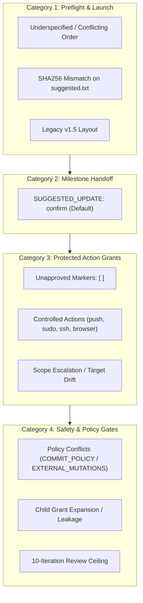
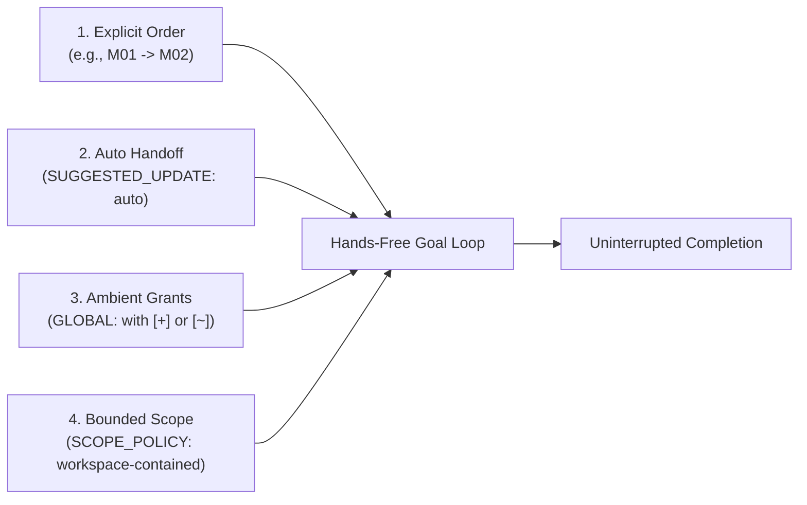

# Milestone Authorization Requirements, Grants, and Hands-Free Execution

This guide provides a comprehensive catalog of all manual authorization checkpoints,
decision markers, and permission scopes in the [goal protocol](../GOAL.md) multi-milestone
execution protocol and [`skills/memory-bank-goal`](../skills/memory-bank-goal/SKILL.md),
followed by configuration patterns for hands-free end-to-end autonomous execution.

---

## 1. Design Philosophy: Fail-Safe by Default

Coding agents operating across multiple milestones can perform substantial local
and external mutations. To prevent unintended modifications, data loss, secret
leakage, or unauthorized external actions, the goal protocol is designed to be
**fail-safe by default**:

- **Declarations do not grant authority**: Milestone specifications declare
  `AUTHORIZATION_REQUIREMENTS` (what the milestone needs), but declarations alone
  never schedule actions or confer permission.
- **Grants originate from human approval**: An action becomes permitted only
  through explicit human approval manifested in `AUTHORIZATION_GRANTS`.
- **Instruction-level governance**: These contracts guide the agent's decision loop.
  Existing tool sandboxes, operating system permissions, and credential boundaries
  remain strictly authoritative.

---

## 2. Complete Catalog of Manual Authorization Cases

The protocol defines ten distinct cases across four categories where execution
will pause for manual human confirmation or halt for instruction:



### Category 1: Preflight & Launch Approvals

1. **Underspecified, Derived, or Conflicting Order**:
   - If the request supplies neither `STATUS_ORDER` nor `STATUS_PRIORITY`, the
     orchestrator derives an order from `milestone.md` or `suggested.txt`. The
     orchestrator **must show the complete resolved request and obtain explicit user
     confirmation before dispatching the first task**.
   - If both `STATUS_ORDER` and `STATUS_PRIORITY` are supplied, or if the supplied
     order violates declared milestone dependencies, execution halts to resolve the
     conflict before execution.
2. **Initial Checksum Verification (`suggested.txt`)**:
   - When launching or resuming from `tabilet/memory-bank/suggested.txt`, the orchestrator
     calculates the SHA-256 checksum of the file and verifies it against the hash
     approved by the human. A mismatch halts execution before any task begins.
3. **Legacy Repository Layout**:
   - If `memory-bank/`, `evolution/`, or `GOAL.md` exists in a legacy v1.5 layout
     (at the project root instead of under `tabilet/`), the skill stops immediately
     and directs the user to run the migration CLI (`migrate-v1.5-to-v2.py`).

### Category 2: Cross-Milestone Progress Updates

4. **Default `SUGGESTED_UPDATE: confirm`**:
   - After a milestone is completed, verified, and retired, the orchestrator updates
     `suggested.txt` to prune closed rows and advance to remaining milestones.
   - Under the default policy (`SUGGESTED_UPDATE: confirm`), modifying `suggested.txt`
     changes its SHA-256 hash, **requiring a fresh manual human approval before
     dispatching the next milestone**.

### Category 3: Protected Action Grants

5. **Grants Marked `[ ]` (Need Authorization)**:
   - Any grant in `AUTHORIZATION_GRANTS` marked with `[ ]` indicates a proposed action
     awaiting human confirmation. If an agent attempts that action, the loop pauses
     and prompts the user with the action, executor, and concrete scope.
6. **The Six Controlled Action Types**:
   - `git.push`: Always pauses unless granted explicitly (`[+]` or `[~]`) with exact
     `repository`, `remote`, `ref`, and `mode: fast-forward`. Local integration
     (`INTEGRATION: local-rebase-ff`) only authorizes local rebasing, not remote push.
   - `browser`: Pauses for explicit approval of target origins, environment, and actions.
     A requirement declared for a `fixture` environment (disposable synthetic pages, no
     real origin, credential, saved session or user data) may instead run under goal policy.
   - `sudo`: Always pauses for explicit approval of specific privileged commands. Blanket
     grants (such as `sudo: true`) are rejected.
   - `ssh`: Pauses for explicit approval of target host, user, and command list.
   - `cli.local` (Non-Standard): Ordinary build and test commands within task scope are
     covered by `declared-implementation-and-verification`. Package installations
     (`apt`, `npm install -g`), environment alterations, or external network scripts
     require explicit grants.
   - `git.commit`: Governed by `COMMIT_POLICY`. Commits outside the active policy
     require explicit authority.
7. **Scope Escalation and Target Drift**:
   - If a grant is approved for `https://github.com/my-org/repo.git` on branch `main`,
     an attempt to push to `release` or an unexpected remote URL pauses for fresh
     approval. Reusing an existing grant requires an exact scope match.

### Category 4: Safety & Policy Gates

8. **Governing Policy Conflicts**:
   - If `COMMIT_POLICY: none` is set, commits are forbidden even if a grant includes
     `git.commit`.
   - If `EXTERNAL_MUTATIONS: none` is set, all external push or network side effects
     are blocked regardless of grant declarations.
9. **Sub-Agent and Worker Isolation**:
   - Delegated review and reconciliation workers receive strictly read-only briefs;
     they possess no mutation authority.
   - Child workers cannot expand grants or inherit coordinator-only grants
     (e.g., repository push).
10. **Bounded Review Gate (10-Iteration Ceiling)**:
    - Each milestone must pass its authoritative code review gate within 10 iterations.
    - If iteration 10 still contains P1 (blocking) or P2 (material) defects, the gate
      fails permanently, the status is marked `[!]` (blocked), and execution pauses
      for human intervention rather than continuing to spend model resources.

---

## 3. Decision Markers Reference

Grants declared in `AUTHORIZATION_GRANTS` use four standardized bracketed markers:

| Marker | Name | Behavior |
|---|---|---|
| `[ ]` | **Need Authorization** | Default proposed state. Execution pauses at runtime to request interactive confirmation before executing the action. |
| `[+]` | **Approved** | Unconditionally approved by the human. Activated for execution upon matching checksum verification without further prompts. |
| `[~]` | **Auto / Conditional** | Pre-approved safe or conditional operations. Operates autonomously under governing goal policy (e.g. verification tests, or conditional push when downstream milestones require publishing). |
| `[-]` / `[X]` | **Denied** | Explicitly forbidden. If the task requires this action, it cannot proceed and must report a blocker. |

---

## 4. Hands-Free End-to-End Execution

To achieve uninterrupted, zero-touch execution across an entire milestone sequence,
you must configure four primary levers at launch:



1. **Unambiguous Order**: Supply an explicit `STATUS_ORDER` (or `STATUS_PRIORITY`) in
   the initial prompt so the orchestrator does not need to pause for confirmation.
2. **Autonomous Milestone Progression (`SUGGESTED_UPDATE: auto`)**: Authorizes the
   orchestrator to prune completed milestones from `suggested.txt`, recalculate
   checksums in session state, and smoothly advance to the next milestone without
   pausing for manual re-approval.
3. **Ambient Grants (`GLOBAL:`) with `[+]` or `[~]`**: Pre-authorize necessary actions
   globally so child workers inherit authority automatically:
   - `- [~] grant_id: global-local-verify` for local build and test execution.
   - `- [~] grant_id: global-repo-push` for repositories requiring remote publishing
     only when downstream consumers depend on it.
4. **Bounded Scope Policy (`SCOPE_POLICY: workspace-contained`)**: Authorizes the
   orchestrator to automatically bind operations (`git.push` and `cli.local`) to sibling
   repositories located within the active workspace root directory matching authorized
   organization remotes, eliminating repeated interactive pauses on repository discovery.

### Conditional Push (`[~]`) for Multi-Package Development

In multi-package ecosystems (such as Go modules, npm packages, or Rust crates),
milestones across multiple packages may have publication dependencies:

- A leaf package or standalone internal fix should **not** push to the remote git repository.
- A foundational library package **must** push to the remote repository so that subsequent
  milestones can run `go get <module>@<version>` or `npm install`.

Using `- [~] grant_id: global-repo-push`:
1. The default stance is **no remote push** for normal internal milestones.
2. If a subsequent milestone in the goal order depends on the package being published,
   the orchestrator autonomously executes the push without pausing for human confirmation.
3. No credentials or secrets are stored in the grant definition; the agent relies on the
   existing host git credentials (`~/.ssh` or credential helper).

### Scope Invariant: Changed Scope Still Requires Fresh Approval

A critical safety principle is that **hands-free execution is never wildcard authority**:

The protocol's invariant rule is:
> *Reuse a valid grant without repeated approval; changed scope requires fresh approval.*

How `SCOPE_POLICY` interacts with this rule:
- **Under `SCOPE_POLICY: strict` (Default)**: Grants require exact letter-for-letter string matching.
  Any new sibling repository path, unexpected destination ref, or remote URL pauses for human confirmation.
- **Under `SCOPE_POLICY: workspace-contained`**: The orchestrator auto-authorizes sibling repositories
  inside the active workspace directory (e.g. `~/Workspace/*`) and matching the authorized remote organization
  (e.g. `github.com/openudon/*`), without pausing.
- **Non-Bypassable Safety Gates**: Any action targeting outside the active workspace directory
  (e.g. `/etc`, `/tmp`, home root), pushing to foreign or unapproved external remotes, or invoking
  elevated privileges (`sudo`, `ssh`) **always pauses** for explicit human approval. Hands-free policies
  never confer blanket or arbitrary system authority.

---

## 5. Milestone-Attached Policies vs. Monolithic suggested.txt

A common friction in large multi-milestone workflows is file bloat in `suggested.txt`. When dozens of
milestones inline their individual requirements, historical trials, and exception scopes into `suggested.txt`,
the file can swell to over 1,000 lines. This makes launch references fragile, hard to audit, and forces
frequent SHA-256 recalculations.

### Architectural Solution: Milestone-Attached Policies

The goal protocol separates high-level launch parameters from milestone-specific constraints:

1. **Lean Launch Reference (`suggested.txt`)**: Contains only goal-level orchestration parameters
   (`STATUS_PRIORITY`, `PARALLELISM`, `SUGGESTED_UPDATE: auto`, `SCOPE_POLICY: workspace-contained`,
   and ambient `GLOBAL:` grants). It stays concise (~30 lines).
2. **Milestone Specification (`tabilet/memory-bank/milestone.md`)**: Each milestone specification
   attaches its own local requirements, verification constraints, and policy overrides (e.g. declaring
   a narrower `EXTERNAL_MUTATIONS`, or milestone-specific action prohibitions `[-]`).

### Precedence and Override Rules

- **Milestone Overrides Win**: A policy or grant attached to a milestone specification takes precedence
  over global launch defaults for the duration of that milestone's lease and execution.
- **Denial Precedence**: An explicit `[-]` (deny) attached to a milestone overrides an ambient `[+]` or
  `[~]` global grant. For example, if `GLOBAL:` permits repository pushes, a milestone declaring
  `- [-] grant_id: push` is strictly forbidden from pushing.
- **Clean Lifecycle**: When a milestone completes and is retired to `docs/history/`, its local policy
  overrides retire with it, leaving the global baseline untouched.

### Comparison: Monolithic vs. Lean Reference

````carousel
```text
# Monolithic suggested.txt (1,000+ Lines)
# Contains entire catalog of 12 milestones, all individual grants,
# trial outputs, historical receipts, and inlined exception scopes.
COMMIT_POLICY: task
STATUS_PRIORITY: M56, W20, M52, W21, U15, M53, A32, M54?, ...
AUTHORIZATION_GRANTS:
  GLOBAL:
    - [~] grant_id: global-local-verify
  Kinet:M56:
    - [~] grant_id: stg12-kinet-m56-bootstrap-browser
      ... 30 lines ...
    - [~] grant_id: stg12-kinet-m56-bootstrap-sudo
      ... 30 lines ...
  OpenUdon:A32:
    - [~] grant_id: stg12-openudon-a32-push-main
      ... 25 lines ...
  Udon:M54:
    ... 25 lines ...
  UWS:C11:
    ... 25 lines ...
  # ... hundreds more lines ...
```
<!-- slide -->
```text
# Lean suggested.txt (~30 Lines)
# Global launch reference only; milestone specifics live in milestone.md
Using the memory-bank goal protocol, execute this loop.

STATUS_PRIORITY:
Kinet:M56, Kinet:W20, Kinet:M52, Kinet:W21, Kinet:U15, Kinet:M53, OpenUdon:A32, Kinet:M54?, Udon:M54?, UWS:C11?, APItools:M86?, Kinet:M55?

STATUS_FILE_MAP:
Kinet:M56 = tabilet/memory-bank/status-M56.md
OpenUdon:A32 = ../openudon/tabilet/memory-bank/status-A32.md

PARALLELISM: 3
INTEGRATION: local-rebase-ff
SUGGESTED_UPDATE: auto
COMMIT_POLICY: task
SCOPE_POLICY: workspace-contained

AUTHORIZATION_GRANTS:
  GLOBAL:
    - [~] grant_id: global-local-verify
      action: cli.local
      executor: assigned-agent
      scope:
        task: declared-implementation-and-verification
```
````

---

## 6. Complete Hands-Free Launch Examples

### Example A: Single-Repository Autonomous Milestone Run

For a standalone project executing milestones `M01`, `M02`, and `M03` locally:

```text
Using the memory-bank goal protocol, execute this loop.

STATUS_ORDER: M01 -> M02 -> M03

PARALLELISM: 1
INTEGRATION: none
COMMIT_POLICY: task
SUGGESTED_UPDATE: auto
EXTERNAL_MUTATIONS: none

AUTHORIZATION_GRANTS:
  GLOBAL:
    - [~] grant_id: global-local-verify
      action: cli.local
      executor: assigned-agent
      scope:
        task: declared-implementation-and-verification
```

**Outcome**:
- Runs `M01`, commits each task individually under `COMMIT_POLICY: task`.
- Passes the review-fix gate, reconciles `M02`, and retires `M01` to `docs/history/`.
- Autonomously refreshes `suggested.txt` under `SUGGESTED_UPDATE: auto` and starts `M02`.
- Repeats through `M03` and finishes with zero interactive pauses.

---

### Example B: Multi-Package Go Development with Conditional Push

For a goal spanning a core library `pkg/core` and an API service `services/api`:

```text
Using the memory-bank goal protocol, execute this loop.

STATUS_ORDER: core:M01 -> api:M02

PARALLELISM: 1
INTEGRATION: none
COMMIT_POLICY: task
SUGGESTED_UPDATE: auto
EXTERNAL_MUTATIONS: none

AUTHORIZATION_GRANTS:
  GLOBAL:
    - [~] grant_id: global-local-verify
      action: cli.local
      executor: assigned-agent
      scope:
        task: declared-implementation-and-verification
    - [~] grant_id: global-repo-push
      action: git.push
      executor: coordinator
      scope:
        repository: /workspace/core
        remote: https://github.com/my-org/core.git
        ref: refs/heads/main
        mode: fast-forward
```

**Outcome**:
- Executes `core:M01`. Because `api:M02` imports `core` via Go modules, the orchestrator
  recognizes the downstream import requirement and autonomously pushes `core` to `main`.
- Advances to `api:M02`, imports the newly published version of `core`, implements the API,
  and verifies without interactive interruption.

---

### Example C: Multi-Repository Autonomous Push Grants

When a multi-milestone goal spans multiple distinct Git repositories (e.g., `kinet` and `uws`),
each repository must declare its own explicit 1-to-1 grant rather than combining repositories into a list:

```text
Using the memory-bank goal protocol, execute this loop.

STATUS_ORDER: kinet:M01 -> uws:M02

PARALLELISM: 1
INTEGRATION: none
COMMIT_POLICY: task
SUGGESTED_UPDATE: auto
EXTERNAL_MUTATIONS: none

AUTHORIZATION_GRANTS:
  GLOBAL:
    - [~] grant_id: global-local-verify
      action: cli.local
      executor: assigned-agent
      scope:
        task: declared-implementation-and-verification
    - [~] grant_id: push-kinet
      action: git.push
      executor: coordinator
      scope:
        repository: /workspace/kinet
        remote: https://github.com/openudon/kinet.git
        ref: refs/heads/main
        mode: fast-forward
    - [~] grant_id: push-uws
      action: git.push
      executor: coordinator
      scope:
        repository: /workspace/uws
        remote: https://github.com/openudon/uws.git
        ref: refs/heads/main
        mode: fast-forward
```

**Outcome**:
- Each repository matches its exact path and remote URL deterministically.
- Authority remains strictly bounded with zero ambiguity or Cartesian mis-binding.

---

### Example D: Multi-Package Workspace with SCOPE_POLICY: workspace-contained

When managing a large workspace with sibling repositories (e.g. `kinet`, `openudon`, `udon`, `uws`, `apitools`):

```text
Using the memory-bank goal protocol, execute this loop.

STATUS_PRIORITY: kinet:M01, openudon:A01, uws:M02

PARALLELISM: 3
INTEGRATION: local-rebase-ff
COMMIT_POLICY: task
SUGGESTED_UPDATE: auto
SCOPE_POLICY: workspace-contained
EXTERNAL_MUTATIONS: none

AUTHORIZATION_GRANTS:
  GLOBAL:
    - [~] grant_id: global-local-verify
      action: cli.local
      executor: assigned-agent
      scope:
        task: declared-implementation-and-verification
    - [~] grant_id: global-repo-push
      action: git.push
      executor: coordinator
      scope:
        repository: /home/peter/Workspace/*
        remote: git@github.com-tabilet:OpenUdon/*.git
        ref: refs/heads/main
        mode: fast-forward
```

**Outcome**:
- The orchestrator automatically binds `git.push` to any sibling repository within `/home/peter/Workspace/*` targeting the `OpenUdon` organization.
- Eliminates manual prompts when new sibling repositories are discovered or integrated.
- Sibling repository policies in `milestone.md` can still attach narrower restrictions (e.g., `- [-] grant_id: push` to disallow push for specific milestones).

---

## 7. Summary Comparison: Default vs. Hands-Free

| Dimension | Default Behavior | Hands-Free Autonomous Configuration |
|---|---|---|
| **Goal Order** | Pauses if derived or ambiguous | Explicit `STATUS_ORDER` or `STATUS_PRIORITY` in request |
| **Milestone Handoff** | Pauses on `suggested.txt` edits (`confirm`) | `SUGGESTED_UPDATE: auto` |
| **Scope Resolution** | Pauses on unlisted repo or ref (`strict`) | `SCOPE_POLICY: workspace-contained` auto-resolves sibling repos |
| **Milestone Policies** | Monolithic inlined grants in `suggested.txt` | Milestone-attached policies in `milestone.md` override/narrow global defaults |
| **Local Verification** | Unchecked if undeclared | `- [~] grant_id: global-local-verify` |
| **Remote Git Push** | Pauses on `[ ]` or rejected | `- [~] grant_id: global-repo-push` |
| **Defect Loops** | Loops up to 10 review iterations | Auto-fixes P1/P2; stops if unresolved at iteration 10 |
| **Secrets / Credentials** | Pauses for human input | Maintained as non-bypassable human boundary |
| **Planning Stance** | `--environment sandbox` (Default) | `--environment dangerous [modifiers]` |

---

## 8. Declarative Planning Stance (`--environment` Option)

Rather than hand-crafting `SUGGESTED_UPDATE`, `SCOPE_POLICY`, `COMMIT_POLICY`, and `GLOBAL:`
grants when authoring plans, planning skills (`memory-bank-init`, `memory-bank-propose`, and
`memory-bank-reconcile`) provide the `--environment` option:

### Base Environments

1. **`--environment dangerous`**:
   - Synthesizes hands-free defaults into `suggested.txt`:
     - `SUGGESTED_UPDATE: auto`
     - `SCOPE_POLICY: workspace-contained`
     - `COMMIT_POLICY: task`
     - Ambient `GLOBAL:` grants with `[~]` for verification and `[+]` or `[~]` for git push (within workspace organization remotes).
   - Preserves core security invariants: destructive or privileged operations (`sudo`, `ssh`, live browser, or external repository push outside the active workspace) remain ungranted (`[ ]` or omitted) unless an explicit modifier authorizes them.
   - Emits recommended harness runner flags in launch comments (`# Recommended harness flags: ALLOW_UNSANDBOXED_SHELL=1`).
2. **`--environment sandbox`** (Default):
   - Standard fail-safe configuration: `SUGGESTED_UPDATE: confirm`, `SCOPE_POLICY: strict`, `COMMIT_POLICY: task`, `AUTHORIZATION_GRANTS: {}` (or proposed grants marked `[ ]`).
3. **`--environment least`**:
   - Strict least privilege: `SUGGESTED_UPDATE: confirm`, `SCOPE_POLICY: strict`, all actions require manual confirmation `[ ]`, `AUTHORIZATION_GRANTS: {}`.

### Natural Language Modifiers

- **`plus <action>`** (e.g., `--environment dangerous plus sudo`):
  - Adds explicit approval (`[+]`) for `<action>` in the milestones/tasks requiring it.
  - If `plus sudo` is granted, includes `# Recommended harness flags: ALLOW_UNSANDBOXED_SHELL=1 ALLOW_DANGEROUS_COMMANDS=1`.
- **`minus <action>`** / **`deny <action>`** (e.g., `--environment dangerous minus git.push`):
  - Explicitly sets `<action>` to `[-]` (denied).
- **`but <action> in milestone <status-XNN.md | MNN>`** (e.g., `--environment least but cli.local in milestone status-X00.md`):
  - Attaches a local milestone policy override directly to the milestone specification in `tabilet/memory-bank/milestone.md` without polluting global launch references.

### LLM API Runner Integration (`harness/tackle-memory-bank-api-loop`)

The standalone Python runner accepts `--environment` (or `LLM_ENVIRONMENT`):
- `--environment dangerous`: Auto-acknowledges host shell access (`ALLOW_UNSANDBOXED_SHELL=1`), clearing exit code 14. Command guardrail `DANGEROUS_RE` remains active against `sudo` unless `--allow-dangerous` is also provided.
- `--environment sandbox` (Default): Standard behavior (requires explicit `ALLOW_UNSANDBOXED_SHELL=1`).
- `--environment least`: Strictly disallows unsandboxed host shell execution, halting with exit code 14.
